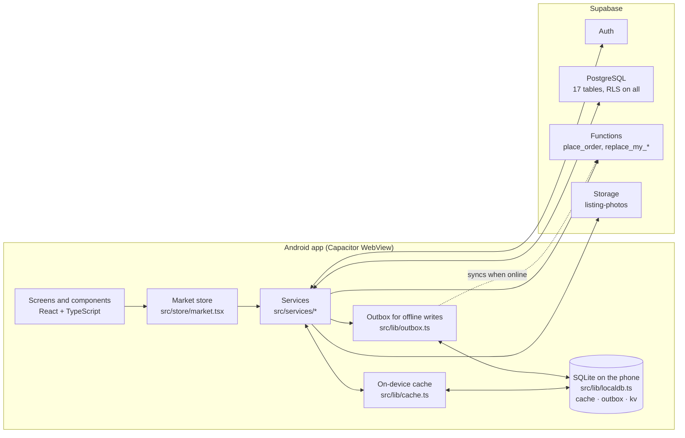

# AniSense

**Ani mo, alam mo.** A mobile app that gives farmers in Nueva Ecija, Philippines, current crop prices and price forecasts, a direct marketplace, expense and profit tracking, and weather for fieldwork, and lets buyers anywhere in the country buy straight from those farmers.


## Table of contents

- [Overview](#overview)
- [Features](#features)
- [Project status](#project-status)
- [Tech stack](#tech-stack)
- [Architecture](#architecture)
- [Getting started](#getting-started)
- [Website](#website)
- [Project structure](#project-structure)
- [Further reading](#further-reading)
- [License](#license)

## Overview

Farmers often sell without knowing the market price, and buyers rarely reach farmers directly. AniSense puts both on one app:

- **Farmers** see the latest prices for their crops, post harvests for sale, record expenses and sales, and check the weather before fieldwork.
- **Buyers** browse fresh harvests, compare them against market prices, and order directly from the farmer who grew them.

The app is designed for users aged 50 to 70 on budget Android phones: text is 16px or larger, every control is at least 52px tall, the interface is available in English and Tagalog, and the app opens and keeps working without a signal, from its own SQLite database on the phone.

The study behind the app focuses on four crops: rice, onion, garlic and calamansi. These are the crops with real price records and forecasts.

## Features

### For farmers

| Feature | Description |
|---|---|
| Prices | Monthly retail prices with the change from the month before. The study's five varieties (Special Rice, Well Milled Rice, Red Onion, Native Garlic, Calamansi) come from real records, 2021 to 2026, and are pinned at the top of the list as "AniSense focus crops". Each opens a chart of the current year from January, followed by a 3-month forecast. |
| Marketplace | Post a harvest with a photo, price and quantity; edit or remove it. |
| Order alerts | A buyer's order appears under the bell with the buyer's name and phone number, a Call button and a Confirm button. Confirm asks what it sold for, and that amount counts in the farmer's earnings; it can be changed afterwards. |
| Expenses and profit | Record costs by category and crop, record sales, and see estimated and final profit. |
| Crop tracker | Log plantings and count down to harvest. |
| Price alerts | Set a target price for a crop and get notified in the app when it is reached. |
| Price outlook | A 3-month forecast chart (LSTM) and sell-now-or-wait advice (ARIMA) for the focus crops. Each forecast shows how far off the model was when tested; where that error is above 20%, the app says the forecast is too uncertain and gives no advice. |
| Weather | Current conditions, hourly and 5-day outlook, and the best window for fieldwork. See [Project status](#project-status). |
| Achievements | Badges for joining, a first listing, a first sale, and Farmer of the Week, Month and Year. |

### For buyers

| Feature | Description |
|---|---|
| Home | Two AniSense posters taking turns under the search bar (tap one to see it whole, with zoom), fresh listings, the cheapest crops today, the price moves, and Your purchases, shown from the first day with "No purchases yet" until there are some. |
| Featured farmers | The AniSense Farmer of the Week (chosen weekly from the four best-rated) and four more, the buyer's neighbours first. On Home, big profile cards; in the Market, a row of small ones. Both rows slide slowly on their own, stop for a finger, and rest when out of sight. The Farmer of the Week leads, with a moving gold ring, and on Home and on their profile a gold badge. |
| Marketplace | Filter by crop, variety or family; search by crop, farmer or town; sort by price or date. Call Now opens the farmer's number in the dialer. The kilos can be stepped with − and + or typed. A back-to-top button appears once the list is a screen down. |
| Checkout | Add to cart and place an order. Stock is checked and reduced atomically on the server. |
| Receipt | A shareable order receipt. |
| Orders | Each line says whether the farmer has confirmed it after the call. Record payment writes down what was actually paid; once a line is settled on both sides, five stars ask how the farmer was. |
| Farmer profiles | Rating (the average of buyers' stars, "New" until someone rates), years of experience, location and what each farmer grows. |

### Shared

- Sign up and sign in with a mobile number or Gmail address, as a farmer or a buyer.
- Conversational sign-up: one question per screen, with a progress bar.
- A guided first-run walkthrough, replayable from the in-app guide.
- A member ID card, numbered by the database in the order people join (`2026-00001`).
- English and Tagalog throughout. The privacy policy and the terms of service are the exception: they are English only.
- Creating an account starts with first and last name and agreeing to the Terms of Service and Privacy Policy; the next page asks for a CP number or a Gmail address.
- Where you are is picked, not typed: Luzon, Visayas or Mindanao, then the province, the city or town, and the barangay. A farmer's form starts on Nueva Ecija, where most AniSense farmers are; farmers elsewhere pick their own province, and their listings are placed in its towns.
- Works without a signal. Every list the app fetches is saved on the phone; with no signal the app opens on the account saved there, shows the saved lists at once, and queues a farmer's expenses and records until the signal returns. See [Offline design](docs/architecture.md#6-offline-design).
- Each tab keeps its place: its scroll and the page open in it. Back returns to where you were.
- Profile has a Manage account section with the privacy policy, the terms of service and account deletion.

## Project status

The app is feature-complete on the client. Some data sources are still sample data and are listed here so nobody mistakes them for live figures.

| Area | Status |
|---|---|
| Accounts, profiles, listings, orders, expenses, farm records, achievements | Live on Supabase once a project is configured. |
| Demo mode | Without a `.env` file the app runs on built-in sample data, so a build without keys still works for demonstrations. |
| Crop prices | **Real monthly retail prices** for the study's five varieties (`data/historical-prices.csv`, January 2021 to September 2026), bundled in the app and loaded into the database by the seed file. The other 18 varieties have **no price: they show ₱0**, and are left out of every comparison (up/down counts, Biggest moves, "below market", profit estimates, price alerts) until they have records. |
| Price forecasts (ARIMA, LSTM) | Trained on the price records by `ml/train_forecasts.py` (statsmodels and PyTorch, run locally, free). Three months ahead for the five varieties. Tested on the last 12 months: rice is 3 to 9% off on average; onion and calamansi are 28 to 52% off. Results are in `ml/REPORT.md`, known limits in `ml/README.md`. The phone runs no model: it reads the finished forecasts. |
| Weather | **Live**, from [Open-Meteo](https://open-meteo.com/) (free, no key): now, the next hours and five days, for the farmer's own town (found by name, once) or, for a buyer, Nueva Ecija. Saved on the phone, so the last forecast shows offline, marked with when it was fetched. The rain warnings on Home and in the bell come from it. |
| Order alerts for farmers | Live on Supabase: a buyer's order reaches the farmer's bell, and confirming it records what it sold for. Two invented orders stand in for the demo farmer. There are no push notifications yet. |
| Orders, payments and ratings | Live on Supabase: the farmer confirms a line with what it sold for, the buyer records what they paid, and the buyer rates the farmer once both are done. |
| Offline storage | SQLite on the phone (`@capacitor-community/sqlite`): saved lists, the queue of changes made offline, and small records. The app opens on the saved sign-in with no signal. Placing an order and posting a listing still need a connection. In a browser (development) the same data is kept in Preferences. |
| Privacy policy | A draft, English only, in the app (Welcome screen, Create account and Profile → Manage account) and at `site/privacy-policy.html`. Not yet reviewed by a lawyer. |
| Terms of service | A draft, English only (`src/data/termsOfService.ts`), agreed to at Create account and readable under Profile → Manage account. In the app only, not yet on the web. Not yet reviewed by a lawyer. |
| Account deletion | In the app (Profile → Manage account) and on a web page (`site/delete-account.html`), as Google Play requires. |
| Sign-up verification code | **Real once set up: Gmail by email, CP numbers by text.** Create account asks for a 6-digit code before it continues. The `verify-code` Edge Function emails it through Brevo ([database-setup.md](docs/database-setup.md), Step 7) or texts it through Semaphore (Step 8), and checks it on the server. Until a sender is set up, and in a build without a database, the code is made on the phone and shown on screen as a demo. |
| Password reset | **Real once set up.** "Forgot your password?" on Sign in: the Gmail or CP number and a 6-digit code by email or text, then a new password typed twice, which the `verify-code` function sets on the account. For a CP number it says resetting by text is not ready yet until Semaphore is set up (Step 8). In a build without a database it is a demo. |
| Automated tests | None yet. `npm run build` type-checks the project, and CI runs it on every push. |

## Tech stack

| Layer | Technology |
|---|---|
| UI | React 18, TypeScript 5 |
| Build | Vite 5 |
| Native shell | Capacitor 8 (Android) |
| Backend | Supabase: PostgreSQL, Auth, Storage, Row Level Security, PL/pgSQL functions, an Edge Function for verification codes |
| On-device database | SQLite, through `@capacitor-community/sqlite` 8 (Android) |
| Icons | lucide-react |
| Styling | CSS-in-TypeScript stylesheets with shared design tokens |
| Image tooling | sharp (development only) |
| Forecast models | Python with statsmodels (ARIMA) and PyTorch (LSTM), run on a development computer. Not part of the app. |

Capacitor plugins in use: App, Filesystem, Haptics, Keyboard, Preferences, Share, Splash Screen, Status Bar, and the community SQLite plugin.

## Architecture



Key design decisions:

- **One data layer.** Screens read and write through the market store (`src/store/market.tsx`). It serves live data when Supabase is configured and sample data otherwise, so screens never branch on the mode.
- **The database enforces the rules.** Row Level Security is enabled on every table. Checkout runs in a single server function (`place_order`) that takes the price from the listing and refuses to oversell.
- **Works without a signal.** Every read is saved per account in a SQLite database on the phone; with no signal the app opens on the saved sign-in and serves those copies at once. A farmer's expenses and records made offline wait in an outbox table and sync, in order, when the connection returns.
- **No client-side secrets.** The app ships only the publishable key.

## Getting started

### Prerequisites

| Tool | Version | Needed for |
|---|---|---|
| Node.js | 22 or newer | Development and builds |
| npm | 10 or newer | Dependencies |
| JDK | 21 | Android builds |
| Android Studio and Android SDK | SDK Platform 36 | Android builds and emulators |
| Supabase account | Free tier | Live data (optional for demo mode) |
| Python | 3.11 or newer | Only to retrain the forecasts (see `ml/README.md`) |

### Commands

| Command | What it does |
|---|---|
| `npm run dev` | Runs the app in a browser for development. |
| `npm run build` | Type-checks and builds the web app into `dist/`. |
| `npm run check:db` | Checks that the Supabase project in `.env` is set up correctly. |
| `npm run prices` | Rebuilds the bundled price history from `data/historical-prices.csv`. |
| `npm run forecasts` | Trains and tests ARIMA and LSTM again and rewrites the forecasts. |
| `npm run seed` | Rewrites `supabase/seed.sql` from the crop catalog, the price records and the forecasts. |

## Website

`site/` is the AniSense website: plain HTML with no build step.

| Page | File | Notes |
|---|---|---|
| Home | `site/index.html` | What AniSense does, in English and Tagalog, with screenshots of the app (`site/assets/screens/`, in both languages). |
| Privacy policy | `site/privacy-policy.html` | Generated from `src/data/privacyPolicy.ts` by `node scripts/build-privacy.mjs`. Never edit it by hand. |
| Delete account | `site/delete-account.html` | Signs a person in and deletes their account without the app, as Google Play requires. Reads `site/config.js`. |

`site/config.js` holds the Supabase URL, the publishable key, the support email address and the app's Google Play address. The home page's "Get it on Google Play" badge (Google's own, in `site/assets/google-play-badge.png`) is not a link until `playStoreUrl` is filled in.

**Publishing on Vercel:** import the repository, set **Root Directory** to `site`, no build command. `site/vercel.json` turns on clean addresses, so the two pages Google Play asks for are `https://<domain>/privacy-policy` and `https://<domain>/delete-account`. Add a custom domain under the project's **Settings → Domains**.

## Project structure

```
AniSense/
├── .github/workflows/   CI build check
├── android/             Native Android project (Capacitor)
├── data/                Price records: historical-prices.csv, and raw/ for the source PDF
├── design/              Brand files (brand/) and full-size artwork (artwork/); not loaded by the app
├── docs/                Documentation: architecture, database setup
├── ml/                  ARIMA and LSTM training (Python) and the test report
├── scripts/             Build and maintenance scripts (Node)
├── site/                The website: home page, privacy policy, account deletion (Vercel)
├── src/                 The app (React + TypeScript)
│   ├── assets/          Images bundled in the app
│   ├── components/      Reusable UI, grouped by feature
│   ├── constants/       Shared constant values
│   ├── data/            Crop catalog, locations, privacy policy and terms text, price records and forecasts
│   │   ├── demo/        Sample data for demo mode
│   │   └── generated/   Written by scripts; never edited by hand
│   ├── hooks/           React hooks
│   ├── lib/             Supabase client, the phone's SQLite database, offline cache and outbox, platform helpers, domain helpers
│   ├── screens/         One file per screen; auth/ holds sign-up and sign-in
│   ├── services/        The only code that calls Supabase
│   ├── store/           App state: the market store and the viewer context
│   ├── styles/          Stylesheets and design tokens
│   ├── types/           Shared TypeScript types
│   ├── App.tsx          App shell
│   ├── i18n.tsx         English and Tagalog strings
│   └── main.tsx         Entry point
├── supabase/            Database schema, seed data, reset script
├── capacitor.config.ts
├── index.html
├── package.json
└── vite.config.ts
```

## Further reading

| Document | What it covers |
|---|---|
| [docs/architecture.md](docs/architecture.md) | How the app is built and why, including how it works offline (section 6). |
| [docs/database-setup.md](docs/database-setup.md) | Connecting a Supabase project, step by step. |
| [supabase/README.md](supabase/README.md) | The database tables, functions and everyday admin. |
| [ml/README.md](ml/README.md) | The forecast models: setup, retraining, testing and limits. |
| [ml/REPORT.md](ml/REPORT.md) | The models' test results. Generated. |


## License

This repository does not yet include a license. Until one is added, all rights are reserved by the author.

---

Maintained by [@yslruzly](https://github.com/yslruzly).
