# AniSense architecture

This document describes how AniSense is built: its parts, how they depend on each other, how data moves, and the decisions behind that. For setup and build instructions see [README.md](../README.md) and [database-setup.md](database-setup.md); for the database tables see [supabase/README.md](../supabase/README.md).

## Contents

1. [System overview](#1-system-overview)
2. [Constraints that shaped the design](#2-constraints-that-shaped-the-design)
3. [Client architecture](#3-client-architecture)
4. [Backend architecture](#4-backend-architecture)
5. [Key flows](#5-key-flows)
6. [Offline design](#6-offline-design)
7. [Security](#7-security)
8. [Build and delivery](#8-build-and-delivery)
9. [Decision log](#9-decision-log)
10. [Known limitations and planned work](#10-known-limitations-and-planned-work)

## 1. System overview

AniSense is a single-codebase mobile app: a React and TypeScript web app packaged for Android with Capacitor, backed by Supabase.

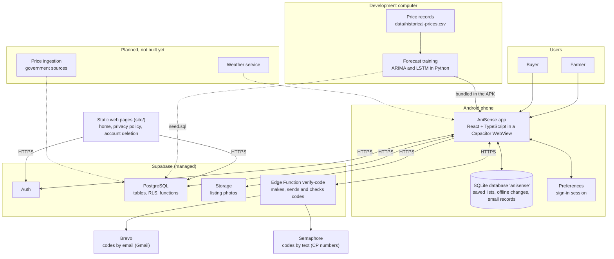

There is no custom application server. The app talks to Supabase directly, and every rule that matters (who can read what, how an order is priced, how stock is reduced) is enforced inside the database.

On the phone, the app keeps its own SQLite database: the last copy of every list it fetched, the changes made without signal, and small records. With no signal it opens on the sign-in saved on the phone and works from that database (see [6](#6-offline-design)).

The verification codes used when creating an account and when resetting a password come from the `verify-code` Edge Function, which emails them through Brevo or texts them through Semaphore and checks them on the server (see [3.9](#39-verification-codes)). In a build without a database, the app makes them itself and shows them on screen as a demo.

The forecast models are not part of the running system. They are trained on a development computer from the price records, and only their results travel: inside the APK, and into the database through the seed file.

## 2. Constraints that shaped the design

| Constraint | Consequence |
|---|---|
| Users are 50 to 70 years old, on budget Android phones | One codebase tuned for one platform; large type and targets; no gestures required; English and Tagalog. |
| Signal in the fields is unreliable | The app keeps a SQLite database on the phone: it opens with no signal, shows the lists it saved, and queues a farmer's records to sync later. Prices, their history and the forecasts ship inside the app. |
| The study is in Nueva Ecija, but farmers elsewhere may join | Sign-up covers the whole country (island group, province, town, barangay); a farmer's form starts on Nueva Ecija. |
| The price records are monthly | Every price move is worded "from the month before", never "today"; forecasts look three months ahead. |
| Forecasts can be badly wrong for volatile crops | Each forecast carries its tested error, and above a set error the app gives no sell-or-wait advice. |
| A small team and no operations budget | A managed backend with no server to run; business rules in SQL, next to the data. |
| The app must be demonstrable before the backend exists | A demo mode that runs entirely on bundled sample data. |
| The key shipped in the app is public | Security cannot depend on the client; Row Level Security on every table. |

## 3. Client architecture

### 3.1 Layers

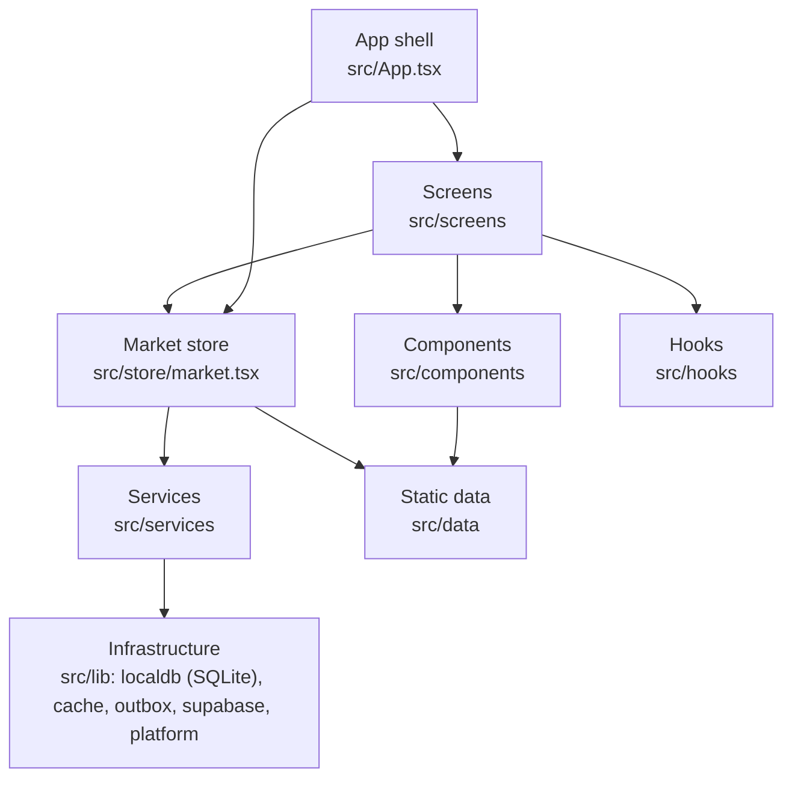

| Layer | Location | Responsibility |
|---|---|---|
| App shell | `src/App.tsx` | Authentication state, which screen is showing and where each tab was left, session restore (offline included), the walkthrough and achievement overlays. Injects the stylesheets. |
| Screens | `src/screens/` | One file per screen. Compose components and read from the store. |
| Components | `src/components/` | Reusable UI, grouped by feature (`home`, `analytics`, `expenses`, `marketplace`, `prices`, `legal`, `profile`, `tour`), plus shared building blocks (`ui`, `layout`, `icons`, `brand`, `states`, `charts`). `legal` shows the privacy policy and the terms of service, as a page or in a sheet. |
| Store | `src/store/` | `market.tsx`, the single data layer, and `viewer.ts`, the context that says who is looking. The market store holds listings, sellers, purchases, expenses, farm records, a farmer's incoming orders, prices and badges, and exposes actions to change them. |
| Services | `src/services/` | One file per domain (`auth`, `listings`, `transactions`, `expenses`, `farmRecords`, `catalog`, `prices`, `sync`, `verification`). The only code that calls Supabase, and the one place the verification codes are made and checked. |
| Hooks | `src/hooks/` | Small React hooks: Android's Back button, offline state, the outbox count, when to show skeleton loaders, presence, night mode, loading a resource, and rows that slide on their own (`useAutoScroll`, the featured farmers). |
| Infrastructure and helpers | `src/lib/` | The phone's SQLite database (`localdb.ts`, `localdbSql.ts`), Supabase client, cache, outbox, platform wrappers (haptics, status bar, keyboard), and small domain helpers (alerts, achievements, plantings, sales, ratings, purchases, featured farmers). |
| Static data | `src/data/` | The crop catalog, Philippine locations, the privacy policy and terms of service, and the readers for the price records and forecasts. Two subfolders: `generated/`, written by scripts and never edited by hand, and `demo/`, the sample data for demo mode. |

**Dependency rule:** screens and components never import the Supabase client. They read and write through the store, which decides whether to call a service or use sample data. This keeps the live and demo modes from leaking into the UI.

### 3.2 Two modes

The store picks a mode from one condition: Supabase is configured **and** a real account is signed in.

| | Live | Demo |
|---|---|---|
| When | `.env` is present and an account is signed in | No `.env`, or the demo sign-in |
| Data source | Supabase | Bundled sample data in `src/data/` |
| Writes | Database (queued when offline, where supported) | Memory, with farm records kept on the phone |
| Purpose | Real use | Demonstrations and development without a backend |

### 3.3 State

State lives in React, with no external state library:

- **`App.tsx`** owns authentication and navigation state.
- **`MarketContext`** provides the market store to every screen.
- **`ViewerContext`** provides who is looking (role and location) and what is waiting for them (price alerts, plantings, incoming orders) to the header, which every screen shares.
- **`LanguageProvider`** provides the language and the translation functions.

### 3.4 Navigation

Navigation is state, not URLs. There is no router, because the app has no addresses to share and runs inside a WebView.

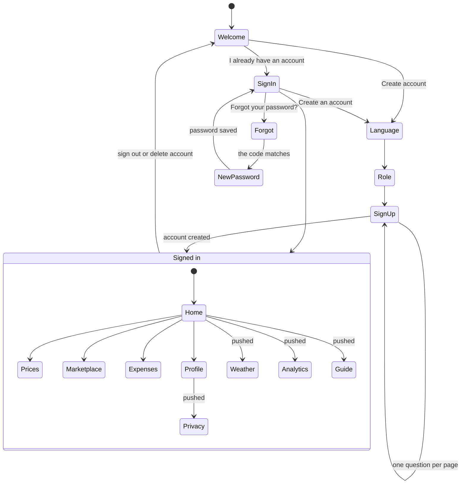

- Before sign-in, an `authScreen` value steps through welcome, language, role and the account form when creating an account. "I already have an account" goes straight from welcome to the Sign in form: a real account brings its own role, and the role of the last account used on the phone (`anisense-last-role`, farmer if none) only picks who greets them and, in the demo, which sample account opens. "Create an account" on that Sign in goes back through language and role, which were skipped.
- Inside the account form (`src/screens/auth/AuthFormScreen.tsx`) a `page` value selects the page: Sign in, the sign-up questions, and the two Forgot password pages (`forgot`, `newpass`).
- After sign-in, an `active` value selects the screen. The five tab screens switch in place; the others are pushed and return on Back.
- Each tab keeps its place. Leaving a tab remembers its scroll and the page open in it (`lastIn`, `scrollAt` in `App.tsx`); tapping that tab again goes back there. Tapping the tab already showing scrolls it to the top, and tapping it from a page opened inside it returns to the tab itself. Back from a pushed page returns to the tab it was opened from, at the same spot.
- Android's hardware Back is handled by a small stack (`useHardwareBack`): the topmost open sheet closes first; inside the account form it steps back one page (a sign-up question, or a Forgot password page); then pushed screens; then the app.

### 3.5 Styling

Styles are plain CSS held in TypeScript strings (`src/styles/*.ts`) and injected with `<style>` tags. A shared token file defines color, type, radius, motion and spacing. This avoids a CSS toolchain and keeps each stylesheet next to the rationale in its comments.

### 3.6 Localization

Every interface string is an entry in `src/i18n.tsx` with English and Tagalog text. Components call `t(key)` for strings and `tn(name)` for crop names. A few market terms stay in English by design. The privacy policy (`src/data/privacyPolicy.ts`) and the terms of service (`src/data/termsOfService.ts`) are English only and are never translated.

### 3.7 Prices and forecasts

| File | Role |
|---|---|
| `src/data/generated/priceHistory.ts` | The monthly price records, generated from `data/historical-prices.csv`. Bundled. |
| `src/data/priceRecords.ts` | Reads the records: a variety's history, its newest price, and the change from the month before. Lays the database's records over the bundled ones when they arrive. |
| `src/data/generated/forecasts.json` | The finished forecasts and each model's tested error, written by `ml/train_forecasts.py`. Bundled. |
| `src/data/forecast.ts` | Reads the forecasts. Hides a forecast month once a real record exists for it, and marks a forecast as unreliable when its tested error is above `RELIABLE_MAPE` (20%). |

- The catalog in `src/data/crops.ts` takes the price of the study's five varieties from the records as it loads. The other 18 varieties have no records, and their prices are sample values.
- The LSTM forecast drives the price charts; the ARIMA forecast drives the sell-or-wait advice and the Home card.
- The phone runs no model and holds no machine-learning library.

### 3.8 Alerts

The bell in the header counts alerts derived from data the app already holds (`src/lib/alerts.ts`): a farmer's incoming orders, plantings that are due, price targets that were met, rain, and the sharpest price moves. Buyers get a different set.

An incoming order is the only alert with actions: it shows the buyer's name and number, a Call button that opens the dialer, and a Confirm button. Confirm asks what it sold for (the order's price already in), and that amount becomes a sale in the farmer's earnings; it can be changed afterwards. The orders come from `order_items` for a real account (`fetchIncomingOrders`), and two sample orders in demo mode (`src/data/demo/orders.ts`).

The buyer's side of the same orders is the Orders page: each line says whether it is still waiting for the farmer's call or confirmed, and "Record payment" writes down what was actually paid. Once a line is settled on both sides (confirmed and paid), five stars ask how the farmer was (`StarRating`); a farmer's rating is the average of those stars, with a count, and a farmer nobody has rated shows "New" and ranks after rated ones (`src/lib/rating.ts`). What a purchase cost is one rule (`src/lib/purchases.ts`): what the buyer paid, else what the farmer confirmed, else the order's price; Total Spent and Home's Your purchases both use it.

### 3.9 Verification codes

Two flows ask for a 6-digit code sent to the CP number or Gmail an account signs in with:

| Flow | Where | What the code proves |
|---|---|---|
| Creating an account | The "how can we reach you" question | The number or address belongs to the person signing up. Continue stays grey until the code passes. |
| Forgot password | The first of the two Forgot password pages | The person resetting the password owns the account's number or address. Only then does the new-password page open. |

Both use `src/services/verification.ts`:

| Function | Does |
|---|---|
| `sendCode(purpose, mode, contact)` | Makes a code for `"signup"` or `"reset"` and the given number or address. A new code replaces the last one. |
| `checkCode(purpose, mode, contact, code)` | Returns `ok`, `wrong`, `expired` or `too-many`. The form checks as soon as the sixth digit is typed. |
| `saveNewPassword(mode, contact, password)` | Saves the new password, only within 10 minutes of a reset code passing, and only once. |

Rules: a code is 6 random digits (`crypto.getRandomValues`), lasts 10 minutes, allows 5 wrong tries and works once; a sign-up code cannot reset a password. The form allows a new code after 30 seconds.

**On the database the codes are real; without one they are a demo.** In a build with a database, the three functions call the `verify-code` Edge Function (`supabase/functions/verify-code/index.ts`): it makes the code, stores only its hash in `verification_codes`, emails it to a Gmail through Brevo or texts it to a CP number through Semaphore's OTP route, checks it, and after a reset code passes hands back a one-time token that `saveNewPassword` needs to set the password. A CP-number account is found by its login address (`639…@phone.anisense.app`), the same way as a Gmail one. Texts cost credits, so besides the per-number limits (one code every 30 seconds, 5 an hour) the function sends to at most `SMS_MAX_PER_HOUR` numbers an hour in all (100 by default). Until a sender is set up (the function not deployed, or no `SEMAPHORE_API_KEY` for a CP number), sign-up falls back to a code made on the phone and shown in a gold "Demo" note, and Forgot password is refused with a plain message rather than faked. In a build without a database it is the demo throughout.

## 4. Backend architecture

Supabase provides four things:

| Service | Use |
|---|---|
| Auth | Accounts and sessions. A mobile-number account is stored as an email alias until SMS verification is added. |
| PostgreSQL | 16 tables in five sections (catalog, accounts, market, farm records, rewards), plus `verification_codes`, which only the verify-code function can read. |
| Edge Functions | `verify-code`: makes the 6-digit codes, emails them (through Brevo) or texts them (through Semaphore), checks them, and sets a new password after a reset. Runs on the server with the service key, which never reaches the app. |
| Functions (PL/pgSQL) | Operations that must be atomic or must not trust the client. |
| Storage | One public bucket for listing photos, written only by the owner. |

Server-side functions:

| Function | Why it runs on the server |
|---|---|
| `handle_new_user` | Creates the profile and crop list when an account is created. |
| `place_order` | Locks the listings, checks stock, takes the price from the listing, writes the order and reduces stock, all in one transaction. |
| `replace_my_sales`, `replace_my_plantings`, `replace_my_price_alerts`, `replace_my_harvest_plans` | Replace one of a farmer's lists in a single step, which makes offline sync idempotent. |
| `set_my_crops` | Replaces the crops a farmer grows. |
| `delete_my_account` | Deletes the caller's own account; takes no argument, so it cannot target anyone else. |
| Award triggers | Grant badges when a profile, first listing or first sale appears. |

The catalog section holds the price records (`crop_prices`) and the forecasts (`crop_forecasts`). Both are written by the seed file, never by the app, and are readable by any signed-in account.

The full table and relationship reference is in [supabase/README.md](../supabase/README.md).

## 5. Key flows

### 5.1 Creating an account

Sign-up collects answers across several pages but creates the account once, at the end. An account created on the first page would be left without a town or crops if the user stopped halfway.

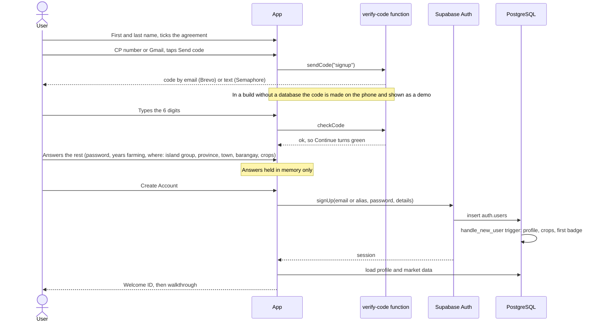

### 5.2 Signing in and resetting a password

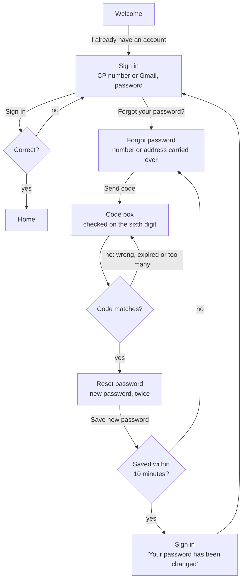

Whatever was typed on Sign in carries over to Forgot password except the password. After a reset the code is used up; another change needs another code.

### 5.3 Checkout

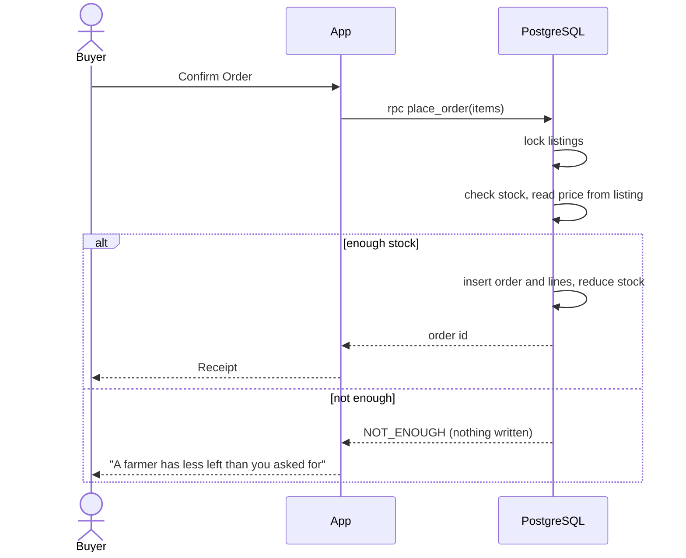

The client sends only listing ids and quantities. Price and seller are read on the server, so a modified client cannot change what it pays.

### 5.4 Reading data

Every read goes through `cachedFetch` (`src/lib/cache.ts`): a successful response is saved in the phone's SQLite database, a failed one falls back to the saved copy, and with no signal at all the saved copy is served at once, without trying the network.

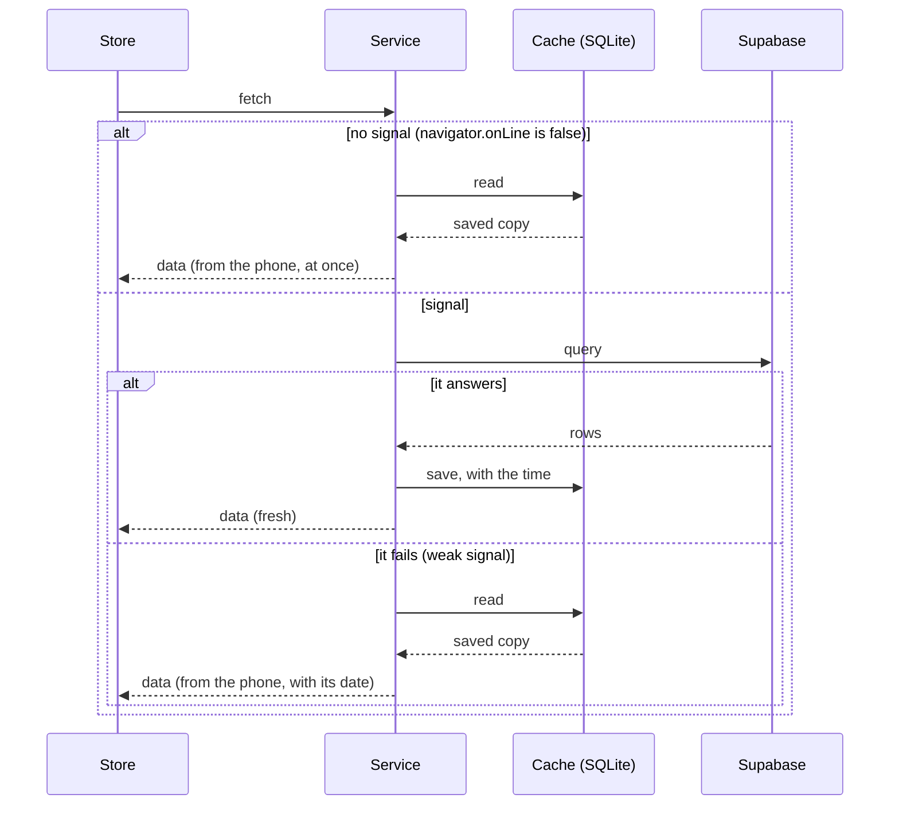

### 5.5 Writing while offline

Expenses (add, edit, delete) and a farmer's records (sales, plantings, price alerts, harvest plans) can be changed with no signal.

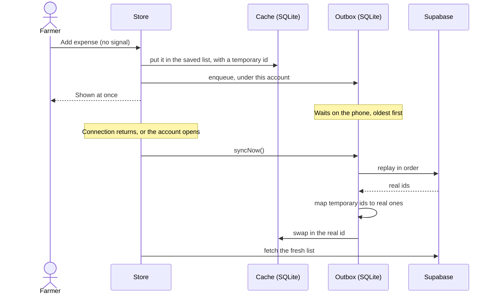

With no signal the change goes to the outbox at once (`throwIfOffline`), rather than after the sign-in library has spent up to half a minute trying to renew an expired session. If sending stops at a failure, that change and everything after it stay queued, in order, with the ids already mapped swapped in.

### 5.6 Opening without signal

A sign-in session lasts an hour; after that the sign-in library renews it over the network. With no signal it cannot, and `getSession()` answers "no session" after up to half a minute of retries, although the session is still saved on the phone. `restoreSession()` (`src/services/auth.ts`) opens on that saved session instead.

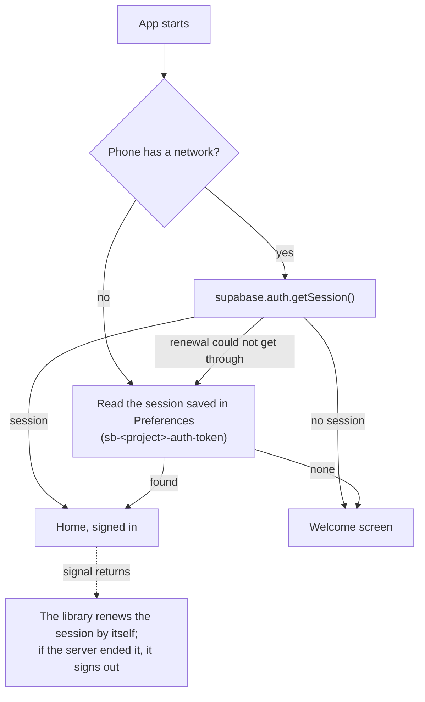

Opened this way, the app works from the SQLite database (5.4, 5.5) and the market store reloads everything when the connection returns.

### 5.7 Deleting an account

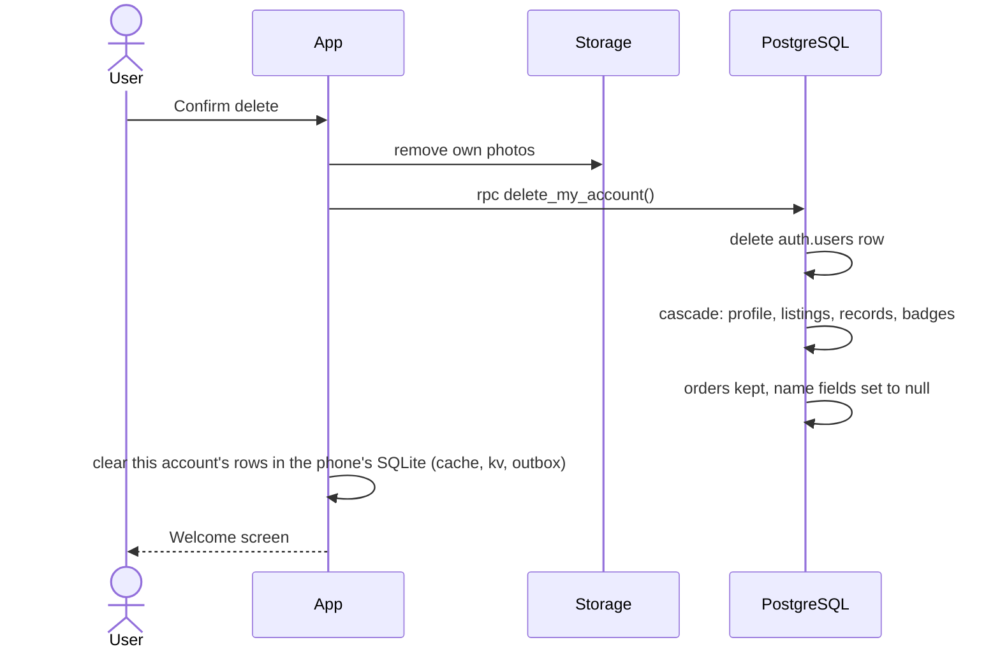

The same function is called by the web page in `site/`, for someone who no longer has the app.

### 5.8 A new month of prices

1. A row is added to `data/historical-prices.csv` (or a newer PDF is imported with `ml/import_pdf.py`).
2. `npm run prices` rebuilds the bundled history.
3. `npm run forecasts` trains and tests both models again and rewrites the forecasts and the report.
4. `npm run seed` rewrites the database's copy, which is then run in the SQL Editor.
5. A new APK carries the update to phones. A phone signed in to a real account also picks it up from the database the next time it is online.

There is no upload inside the app. The steps are in [ml/README.md](../ml/README.md).

## 6. Offline design

The app keeps its own SQLite database on the phone, so it opens and works with no signal. Supabase stays the shared source of truth; the phone's database is each phone's own copy.

| Mechanism | File | Role |
|---|---|---|
| The phone's database | `src/lib/localdb.ts` | Opens the SQLite database `anisense` through `@capacitor-community/sqlite`, runs its upgrades, moves in what older versions kept in Preferences, and hands the store to the rest of the app. In a browser (development, tests), and if SQLite ever fails to open, the same calls use Preferences. |
| Its SQL | `src/lib/localdbSql.ts` | The tables, the numbered upgrades, the one-time move, and every statement, written against a small driver interface so it can be tested on any SQLite engine. |
| Cache | `src/lib/cache.ts` | `cachedFetch`: saves each successful read; serves the saved copy when the network fails, and at once when there is no signal at all. |
| Outbox | `src/lib/outbox.ts` | Queues writes made offline, in order, per account. |
| Sync | `src/services/sync.ts` | Replays the outbox when an account opens or the connection returns. |
| Offline start | `src/services/auth.ts` (`restoreSession`) | Opens on the session saved on the phone when there is no signal (5.6). |

### 6.1 The tables

| Table | Holds | Columns |
|---|---|---|
| `cache` | The last copy of each list fetched, per account (key `<account id>_<list>`), as JSON with the time it was fetched | `key`, `data`, `updated_at` |
| `outbox` | Changes waiting to be sent, oldest first (`seq`), with the account they belong to | `seq`, `id`, `owner`, `type`, `payload`, `queued_at`; index on (`owner`, `seq`) |
| `kv` | Small records of this phone: the demo's sales, plantings, price alerts and harvest plans, which tours and badges were seen, the last member number shown | `key`, `value` |
| `meta` | The database's own bookkeeping: `schema_version`, and when the old Preferences data was moved in | `key`, `value` |

The lists saved in `cache`: for everyone `market`, `market_prices`, `prices_latest`, `price_history`, `price_forecasts`; for a buyer `purchases`; for a farmer `expenses`, `farm_records`, `sales_market`, `orders_in`, `awards`. Each is kept whole and replaced whole by the next successful fetch, which keeps every service unchanged and fits lists that are always shown whole. A list that must one day be searched offline row by row can get its own table through a new upgrade.

The outbox's operation types: `add_expense`, `update_expense`, `delete_expense`, `replace_sales`, `replace_plantings`, `replace_alerts`, `replace_plans`.

### 6.2 Design points

- **Why SQLite.** Preferences (Android's SharedPreferences) keeps each value as one block of text, rewrites it whole on every save, and cannot save several things as one step. SQLite gives tables, an ordered queue, and transactions: the one-time move and every rewrite of the queue are all or nothing. WebView storage (IndexedDB, `localStorage`) was ruled out because Android may clear it when the phone runs low on space.
- **The session stays in Preferences.** The sign-in library keeps it there itself, under `sb-<project>-auth-token` (`SESSION_KEY` in `src/lib/supabase.ts`); `restoreSession` reads it from there.
- **Upgrades.** The schema version is kept in `meta`. Each upgrade in `MIGRATIONS` has a number, runs once, in one transaction; a shipped upgrade is never edited, a new one is added at the end.
- **Moving in.** On the first start with SQLite, everything older versions kept in Preferences (except the session) is copied in one transaction: `cache_*` keys into `cache`, `outbox_ops` into `outbox` in the same order, the rest into `kv`. The move is marked done in `meta` before the old copies are removed, so it never runs twice.
- **No waiting on a network that isn't there.** With no signal, reads come from the phone at once and writes are queued at once; nothing waits on the sign-in library's retries.
- **Bundled data.** The price records and the forecasts are part of the APK, so prices, their charts and the forecasts show on a phone that has never been online.
- **Scoped per account.** Every cache key and queued operation carries the account id, so two accounts on one phone never see or send each other's data. Deleting an account removes its rows.
- **Idempotent sync.** Farm-record lists are saved by replacing the whole list on the server, so replaying an operation twice is harmless.
- **Deliberately online-only.** Posting a listing and checkout need the server because they involve other people's stock. The app says so plainly instead of queuing them.
- **Not encrypted.** The database uses the plugin's no-encryption mode; it lives in the app's private storage and holds no passwords. The plugin supports SQLCipher if encryption is needed later.

### 6.3 Testing it

The SQL in `localdbSql.ts` runs against any SQLite engine through its driver, so it can be tested off the phone (with sql.js). In a browser the app uses the Preferences store, so the app-level tests exercise everything around SQLite; the SQLite plugin itself runs only on a phone. To check on a phone: sign in with signal and open Home and the Market; turn on airplane mode, close the app and open it again. It should open on Home with the saved data, and an expense added then should reach Supabase once the signal is back.

## 7. Security

- **Row Level Security on every table.** Access is decided by the database from the signed-in user's id.
- **Least exposure.** Farmer profiles are visible to signed-in users, because buyers must find them. A buyer's details are visible only to farmers that buyer has ordered from. Farm records are visible only to their owner.
- **Column-level grants.** Users can update their own name, phone, location and bio, but not their rating or sales count.
- **Server-side operations.** Orders can be created only through `place_order`.
- **No secrets in the client.** The app and the web pages use the publishable key only. `npm run check:db` refuses to run if it finds a secret key in `.env`.
- **Passwords** are handled by Supabase Auth and stored hashed.
- **Verification codes** are random, last 10 minutes, allow 5 wrong tries, work once, and are kept apart by purpose. With a database they are made and checked by the `verify-code` function, which keeps only their hash, so the phone never knows a code before the user types it. Only the demo build makes them on the phone.
- **Data on the phone** is in the app's private storage: a SQLite database (not encrypted; no passwords in it) and the session in Preferences. Every saved list and queued change is filed under its account.
- **Transport** is HTTPS throughout.

## 8. Build and delivery

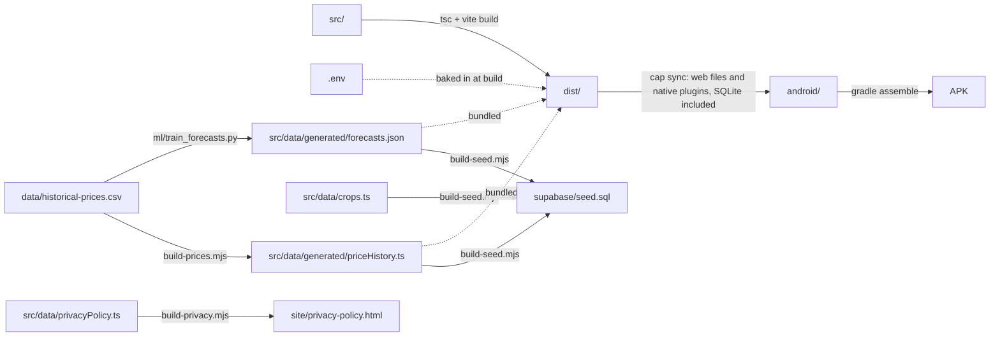

- Environment values are compiled into the bundle, so a build made without `.env` is a demo build.
- Generators keep derived files in step with their source: the database seed is generated from the crop catalog, the price records and the forecasts, and the web privacy policy from the text the app shows.
- Prices follow one path: `data/historical-prices.csv` holds the monthly records. From it come the history the app bundles (so prices show offline), the ARIMA and LSTM forecasts (trained locally in Python, never on the phone), and the database's copy. Signed in, the app lays the database's records and forecasts over the bundled ones, so a new month reaches phones without a new APK.
- `site/` is the website (home page, privacy policy, account deletion): plain HTML that any static host can serve. It is published on Vercel, with `site/` as the project's root directory; `site/vercel.json` gives the pages clean addresses.
- `.github/workflows/ci.yml` type-checks and builds the app on every push and pull request, without `.env`, so it builds the demo.

## 9. Decision log

| Decision | Alternatives considered | Reason |
|---|---|---|
| Supabase as the backend | Firebase, a custom server | Relational data (orders, stock, records) fits SQL; Row Level Security and SQL functions keep rules next to the data; standard PostgreSQL avoids lock-in. |
| Capacitor around a web app | Native Android, React Native, Flutter | One codebase and the fastest iteration; the app needs little native capability. |
| No router | React Router | No shareable URLs inside a WebView; two small pieces of state are simpler. |
| No state library | Redux, Zustand | One store and two small contexts cover the app. |
| CSS in TypeScript strings | Tailwind, CSS modules | No extra toolchain; design tokens and rationale live with the styles. |
| Business rules in SQL functions | Rules in the client or in server functions elsewhere | The client is untrusted; a single transaction is needed for checkout. |
| Mobile-number accounts as an email alias | Supabase phone auth from day one | Phone auth needs a paid SMS provider; the alias can be migrated later without users losing their login. |
| Create the account at the last sign-up step | Create on the first page | Avoids half-complete accounts. |
| Keep orders when an account is deleted, with the name removed | Delete orders with the account | An order is also the other party's record of a sale. |
| One source for the privacy policy | Separate app and web copies | The two can never disagree. |
| Privacy policy and terms of service in English only | English and Tagalog | The owner's decision: one text, so there is never a question of which version is binding. |
| Agree to the terms on the first sign-up page, with a checkbox | A line under the last page's button; no explicit step | Consent is given before any personal detail is typed, and a ticked box is a clear choice. The agreement is not yet stored with the account. |
| "I already have an account" opens Sign in directly | Language and role first, as for a new account | A real account already has its role, and the welcome screen is already in the chosen language. A returning user gets there in one tap. |
| Build the code screens now, behind one service file, as a mockup | Wait for the SMS provider and email sender | The screens could be designed and tested now; connecting the senders changes only `verification.ts`. |
| Check a code as soon as the sixth digit is typed | A separate Verify button | One less button to find; it also suits codes the phone fills in from an SMS. |
| One green button at a time on the code question: Continue stays grey until the code passes | Send code and Continue both green | The next tap is never in doubt. The grey Continue still answers a tap with the reason. |
| Forgot password as two pages with labelled fields and the button right under them | The sign-up layout, with the button at the foot | Follows the owner's reference design, keeps the button in view with the keyboard up, and keeps the green header so it still looks like AniSense. |
| Train the models on a computer and ship the forecasts as data | Run the model on the phone (TensorFlow.js); train in the cloud | The forecast is the same for every user, so it is worked out once. The app stays small, needs no machine-learning library, and works offline. Training takes about a minute on a laptop. |
| Show each model's tested error, and give no advice above 20% | Show every forecast the same way | Onion and calamansi forecasts were 28 to 52% off in testing; a farmer should not hold a harvest on them. |
| Word prices by the month | Keep "today" and "yesterday" | The records are monthly; daily wording would be false. |
| SQLite on the phone for offline storage | Keep Preferences; WebView storage (IndexedDB, `localStorage`) | Tables, an ordered queue and all-or-nothing saves, room to grow, and a file Android does not clear under storage pressure. Preferences stays for the session and as the browser fallback. |
| Keep each saved list whole, as JSON in one row | A table per kind of record | Every service stays as it was, and the lists are always shown whole. A list that needs offline searching can get its own table by an upgrade. |
| Open on the saved session when there is no signal | Wait for the sign-in library to renew it | With no signal the library cannot renew it and answers "no session" after up to half a minute, which put people on the welcome screen. The library still renews it, or signs out, once the signal returns. |
| With no signal, read from the phone and queue writes at once | Try the network first, fall back on failure | A request with no signal only fails, and only after the sign-in library's retries; the saved copy is right there. |
| Sign-up covers the whole country, starting farmers on Nueva Ecija | Nueva Ecija only | Farmers outside the study area can join; most farmers still only pick their town and barangay. |

## 10. Known limitations and planned work

| Area | Current state | Plan |
|---|---|---|
| Crop prices | Monthly records for five varieties, added to a CSV by hand; sample values for the other 18 | Records for the remaining varieties; ingestion from government sources on a schedule. |
| Price forecasts | ARIMA and LSTM trained on the five varieties' records. The ARIMA search picks the differencing order by AIC, which is not the right tool for it; the LSTM's settings were not tuned; neither model can foresee a price shock. | Choose the differencing order with a stationarity test; tune the LSTM with a small grid scored inside the training months; test a seasonal ARIMA; consider extra inputs (weather, costs) as later work. |
| Order alerts | Read from the database, confirmed with what it sold for; sample orders in demo mode | Send a push notification when an order arrives. |
| Weather | Sample values in `src/data/demo/weather.ts` | Connect a forecast service. PAGASA's TenDay API needs a token that PAGASA approves on request, and it gives daily forecasts, not current conditions. |
| Phone and Gmail verification | Real once set up: Gmail through Brevo, CP numbers through Semaphore (both in `verify-code`). Sign-up is gated by the form, not by the server: a modified app could still create an account without a code. | Have account creation itself require a passed code (sign-up through the function), and a domain of our own in Brevo so codes don't land in Spam. |
| Password reset | Real once set up, for Gmail and (with Semaphore) CP-number accounts. | — |
| Offline | The app opens, reads and queues a farmer's records with no signal (section 6). Listing photos never opened with signal and the web fonts are not saved on the phone; placing an order and posting a listing need a connection; the phone's database is not encrypted. | Save listing photos with the market list; bundle the fonts in the APK; consider SQLCipher if records grow more sensitive. |
| Automated tests | None in the repository | Add unit tests for the services and the store (including the phone database's SQL, which runs on sql.js), and database tests for the SQL functions. |
| Continuous integration | Type-check and build on every push (`.github/workflows/ci.yml`) | Run the automated tests there once they exist. |
| iOS | Not targeted | Capacitor supports it if needed later. |
