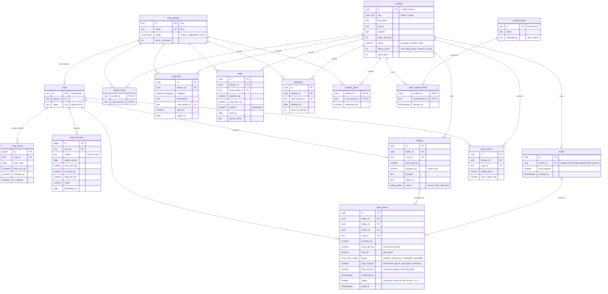

# AniSense database

PostgreSQL on Supabase, in five sections. Every feature of the app keeps its data here once a project is connected (see `docs/database-setup.md`).

| File | What it is | When to run it |
|---|---|---|
| `schema.sql` | Every table, security rule and function | First. Safe to run again. |
| `seed.sql` | The crop catalog, the price records (2021 to 2026), the forecasts, the badges | Second. Safe to run again. Generated by `node scripts/build-seed.mjs` from `src/data/crops.ts`, `data/historical-prices.csv` and the trained forecasts. |
| `reset.sql` | ⚠ Deletes everything | Development only, to start over. |

## How the tables connect



## The tables

**1. Catalog.** What can be grown, sold and priced. Reference data, changed by the admin only.
- `crop_groups`: the 10 crop types (Rice, Corn, Onions…), their family and typical days to harvest.
- `crops`: the 23 varieties (Special Rice, Red Onion, Carabao Mango…).
- `crop_prices`: the retail price records, one per variety per date. The study's five varieties have one record a month from 2021, dated the 1st; `change_pct` is the move from the record before. A variety with no records holds one placeholder marked `is_sample`. The view `crop_prices_latest` gives the newest price of each variety.
- `crop_forecasts`: what ARIMA and LSTM expect for the months ahead, per variety, with the likely range and each model's tested error (`mape`). Written by `seed.sql`, never by the app.

**2. Accounts.**
- `profiles`: one per person, created automatically at sign-up. `member_no` is the number on their ID card, like `2026-00001`: the year they joined (Philippine time) and their place in that year's count, given by the database, never reused, and not editable by anyone.
- `member_counters`: how far each year's member count has got. Only the numbering function uses it.
- `profile_crops`: which crop types each farmer grows.

**3. Market.**
- `listings`: harvests for sale. `quantity_kg` goes down as orders come in.
- `orders`: one per checkout.
- `order_items`: one line per listing bought. Price, crop and seller are copied at the moment of sale, so history never changes. Its `status` starts at `placed`; the farmer may move it to `confirmed` or `completed`.

> The farmer's order alert (name, number, Call, Confirm) reads these lines: a new order is an `order_items` row with `status = 'placed'` for that farmer, and the buyer's name, number and town come from `profiles` (which a farmer may read for buyers who ordered from them). After the call each side keeps its own figure, set through its own function: **`confirm_order_item(item, sold)`**, the farmer's, moves the line to `confirmed` with `sold_amount` (what it sold for, which is what counts in their earnings; a line still `placed` is not a sale yet), and **`record_order_payment(item, paid)`**, the buyer's, sets `paid_amount` (what they paid, which is what their spending counts; `null` clears it). Neither column can be written directly.

**4. Farm records.** Private to each farmer.
- `expenses`: costs by category and crop.
- `sales`: sales made outside the app. Market sales are the farmer's `order_items`.
- `plantings`: what is in the ground, for the harvest countdown.
- `price_alerts`: target prices to watch.
- `harvest_plans`: expected kilos per crop, for estimated profit.

**5. Rewards.**
- `achievements`: the 6 badges.
- `user_achievements`: who earned which, and when.

**11. Admin.** Not part of the app's data.
- `admins`: the accounts that may use the admin website (`site/admin.html`). Row level security with no policies, and closed to the app. An admin has no profile, so it is never one of the app's members, and the app will not sign it in.

**9. Codes.** Not part of the app's data.
- `verification_codes`: the 6-digit codes for creating an account and resetting a password, as hashes, with their expiry and tries. Row level security with no policies: only the `verify-code` Edge Function (with the server's service key) reads or writes it. See `supabase/functions/verify-code/` and database-setup.md, Steps 7 (Gmail, Brevo) and 8 (CP numbers, Semaphore).

## Functions

| Function | Does |
|---|---|
| `handle_new_user()` | Trigger: builds the profile and crop list from the sign-up form |
| `next_member_no(at)` / `set_member_no()` | Gives each new profile the next member number of its year (`2026-00001`, `2026-00002`, …), one at a time even when people join at once. Closed to the app |
| `place_order(items)` | Checkout, all or nothing: checks stock, lowers it, writes the order at the listing's price |
| `set_my_crops(names)` | Replaces the farmer's crop list |
| `replace_my_sales / plantings / price_alerts / harvest_plans` | Saves one of the farmer's lists in one step (used by the app, also after being offline) |
| `award…` triggers | Awards Newbie on sign-up, First harvest on a first listing, First sale on a first sale |
| `delete_my_account()` | Deletes the caller's own account and everything that is theirs alone. Orders stay in the other party's history, with the name removed |
| `catalog_status()` | Counts only, for `npm run check:db` |
| `make_admin(email)` | Makes an account added under Authentication → Users an admin, and takes away the app profile it was given. Refuses an account already used in the app. Run only by the owner, in the SQL Editor |
| `is_admin()` | Whether the person signed in is an admin: the admin website checks it at sign-in, and the app turns an admin away with it |
| `admin_overview()`, `admin_users(…)`, `admin_user(id)`, `admin_listings(…)`, `admin_orders(…)`, `admin_awards()` | What the admin website reads: the dashboard's numbers, the members, one member, the listings, the orders, who holds the admin's badges. Each says `NOT_ADMIN` to anyone else |
| `admin_price_board(month)` | The Prices page: every variety with its price for the month, the record before it, its last 12 records, and when the forecasts were made |
| `admin_set_prices(month, prices, source)` | Saves a month's prices from the Prices page, all or none: puts in, puts right or takes away, then works out each record's move from the one before again. Not a month still to come |
| `admin_set_award(user, badge, on)` | Gives or takes back Farmer of the Month or Farmer of the Year, to a farmer only. The admin website's one change |
| `end_sessions(user, keep)` | Signs an account out on every phone (but `keep`, the phone that changed the password). Used by the verify-code function after a password reset or change. Closed to the app |
| `auth_user_id_by_email(email)` | Which account a login address belongs to, if any (a Gmail, or a CP number's `639…@phone.anisense.app`). Closed to the app; only the verify-code function may call it |

## Security

Row Level Security is on for every table; the database enforces it, not the app.
- Nobody signed out can read anything but the price catalog (for guest mode).
- Accounts are made only by the `verify-code` function, after the 6-digit code it sent has passed: public sign-up is off in Supabase (docs/database-setup.md, Step 3). Codes are kept as keyed hashes; each address or number gets at most 10 codes and 10 wrong tries a day. A password reset signs the account out on every phone.
- Only an account in `admins` can call the admin functions, and they only read, but for the month's prices and the two admin badges.
- Prices are read by everyone (guests too) and written only through `admin_set_prices`. Which admin put a price in (`crop_prices.entered_by`) is never readable from the app or the web; where it came from (`source`) and when (`entered_at`) are.
- Farmers manage only their own listings and records.
- A buyer's phone number is visible only to farmers they have ordered from.
- Orders can only be made through `place_order()`.
- Nobody can edit their own rating, sales count or member number. A farmer's `rating` and `rating_count` are worked out from the stars buyers gave (`order_items.rating`) every time one is given or changed.
- A buyer rates a farmer only through `rate_order_item(item, stars)`: only for a line of their own order, 1 to 5 stars, and only once it is settled on both sides (the farmer confirmed it, the buyer recorded what they paid; `NOT_YET` before that). Rating again changes the stars.
- Farmers can move their own order lines to confirmed or completed, and change nothing else about them; the amount they sold a line for is set only through `confirm_order_item`, and only on their own lines.
- A buyer sets what they paid for a line only through `record_order_payment`, and only on their own orders.
- Anyone can delete their own account, and only their own, through `delete_my_account()`.

## Everyday admin

**Put in this month's prices.** On the admin website, **Prices**: pick the month, type each variety's retail price per kilo from the government's list (optionally where it came from, e.g. DA Bantay Presyo), and **Save prices**. It goes into `crop_prices` at once, dated the 1st of the month, with its move from the month before worked out again. Phones get it the next time they are online, guests too. A month can be put right the same way, and an empty box takes that month's price away. A variety with no price yet (₱0 in the app) gets one the same way.

**Bring the forecasts up to date.** The models are trained on the computer, not on the website, so new prices don't change the forecasts by themselves; the Prices page says when they are behind. Then, on the computer:
```
npm run refresh       data/historical-prices.csv from the database (prices:pull),
                      then the bundled history, the forecasts and seed.sql
```
and run `seed.sql` in the SQL Editor. Build a new APK as well, so first-time and offline phones carry the new months too. Always run `npm run refresh`, never an old `seed.sql`: it starts by copying the database's prices into the CSV, so the seed puts back exactly what is on the website. (`npm run prices:pull -- --check` shows what would change without writing anything.) A variety needs 36 months of prices before it gets a forecast.

**Name a Farmer of the Month or Year.** On the admin website, **Badges** → find the farmer → **Give** (or open the farmer under **Members**). Without the website, copy the farmer's id from Table Editor → `profiles` and run:
```sql
insert into user_achievements (profile_id, achievement_id)
values ('<farmer id>', 'farmer-of-the-month');
```
